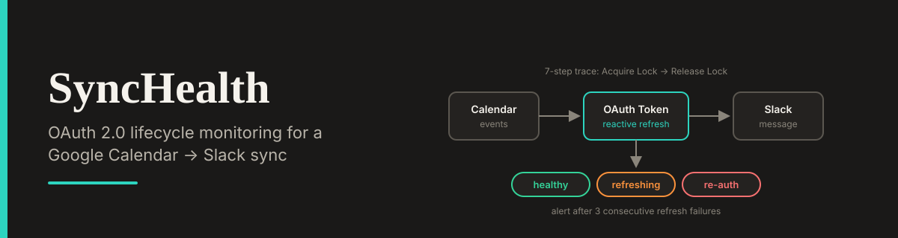

<div align="center">




</div>

# SyncHealth - OAuth Sync Health Dashboard

A premium B2B dashboard that visualizes the full OAuth 2.0 lifecycle of a **Google Calendar → Slack** integration. It simulates reactive token refreshes, failure counting, alert thresholds, and audit logging.

**Live Demo:** [google-slack-sync.lovable.app](https://google-slack-sync.lovable.app)

## The Problem

OAuth integrations break silently. When an access token expires or a refresh attempt fails, the workflow stops processing events, and nobody notices until something downstream is missing.

This dashboard makes credential health visible. It shows the state of the token at a glance, traces exactly what happened on every run, and flags when the integration needs to be re-authorized.

## n8n Workflow Reference

This UI is designed to accompany a self-hosted n8n automation. The backend workflow documentation lives in my platform integration portfolio:

- **Repository:** [platform-integration-portfolio](https://github.com/Xhenzouu/platform-integration-portfolio)

The workflow handles the following logic:

1. Acquires a lock so only one run processes the calendar at a time.
2. Uses the stored access token to fetch Google Calendar events.
3. Reactively refreshes the token when the API reports it has expired.
4. Skips events that were already processed (idempotency).
5. Posts the remaining events to Slack.
6. Writes the outcome of the run to an audit log.
7. Releases the lock.

This simulator mirrors that flow: the pipeline trace shows each step, and the audit drawer exposes the payload for each run.

## Features

- **Token Health Widget:** Real-time token status, consecutive failure counter, and last refresh time.
- **7-Step Pipeline Trace:** A visual trace of each run, from *Acquire Lock* through to *Release Lock*, with per-step status.
- **Alert Thresholds:** A red banner fires when the token fails to refresh 3 consecutive times, signalling that re-authorization is required.
- **Idempotency Testing:** Simulates re-delivery of already-processed events and shows them being skipped.
- **Audit Drawer:** A per-run drawer showing the raw Supabase JSON payload for full traceability.

## Run Locally

1. Clone the repo:

   ```bash
   git clone https://github.com/Xhenzouu/google-slack-sync.git
   cd google-slack-sync
   ```

2. Install dependencies:

   ```bash
   npm install
   ```

3. Start the development server:

   ```bash
   npm run dev
   ```
